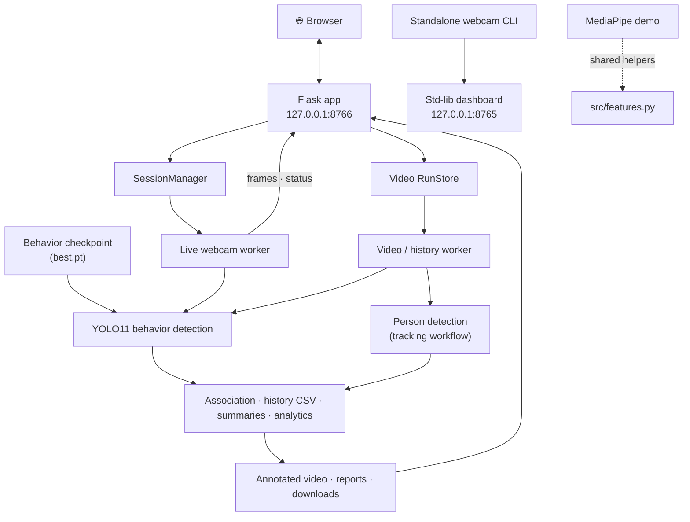

<div align="center">

# 🎓 VisionClass

### Local computer vision for exploring classroom behavior in webcam feeds and recorded video

*Custom-trained **YOLO11** detector · person tracking · per-frame history · run analytics, all running on your own machine.*

<br>


[Features](#-features) ·
[Architecture](#-architecture) ·
[Quick start](#-quick-start) ·
[Usage](#-usage) ·
[Configuration](#️-configuration) ·
[Responsible use](#️-limitations--responsible-use) ·
[Documentation](#-documentation)

</div>

---

> [!IMPORTANT]
> VisionClass is built for **experimentation and review**. It does not establish student identity, learning, or model accuracy in any particular classroom. Behavior boxes are model observations, not ground truth.

## 📖 Overview

VisionClass detects classroom behaviors in webcam streams and uploaded videos using a custom-trained **YOLO11** model. It adds optional person tracking, per-frame behavior history, and CSV-based summaries, all surfaced through a local Flask dashboard.

The expanded **Flask application** supports live webcam sessions, uploaded-video analysis, and run-scoped analytics. The original standalone webcam CLI and its standard-library dashboard on port `8765` remain available during the migration.

<!--
  📸 SCREENSHOTS
  Add reviewed screenshots here (never identifiable classroom footage), for example:
  <p align="center"></p>
-->

## ✨ Features

| | Capability |
|---|---|
| 🎥 **Live & video detection** | Run behavior detection on a webcam or a locally selected video file. |
| 📊 **Live dashboard** | Annotated live frames, current-frame behavior-box counts, and a bounded trend chart. |
| 🧭 **Tracking & history** | For videos, optionally associate detections with per-video tracker IDs (ByteTrack) and export frame history plus tracker summaries. |
| 📁 **Run analytics & reports** | Review analytics per run and download annotated video, CSVs, and generated Markdown/HTML reports. |
| 🛠️ **Standalone tools** | Training, evaluation, video, webcam, and MediaPipe demo scripts for when you need them. |

> These are code-supported capabilities. Results depend on the model, input media, and local hardware. See [Known limitations](docs/KNOWN_LIMITATIONS.md) for evidence boundaries.

### 🏷️ Detected behavior classes

Matching the Roboflow **student_classroom_behavior** export:

`handrise` · `read` · `sleep` · `stand` · `using_electronic_devices` · `write`

## 🏗️ Architecture



The MediaPipe demo is separate from the YOLO pipeline. For the full implementation map and data flow, see [`docs/ARCHITECTURE.md`](docs/ARCHITECTURE.md).

## 🧰 Tech stack

| Area | Tools |
|---|---|
| **Language** | Python 3.12 |
| **Web** | Flask (loopback app) · Python standard library (legacy dashboard) |
| **Vision / ML** | Ultralytics YOLO11 · PyTorch · OpenCV · ByteTrack via `lap` |
| **Data** | NumPy · standard-library CSV |
| **Testing** | pytest |

## 🚀 Quick start

> [!NOTE]
> Python **3.12** is the target environment (tested on 3.12.7). A clean-clone install has **not** been verified. The requirements pin PyTorch to the **CUDA 12.8** build used by the current Windows setup. CPU-only and other-platform users should choose platform-appropriate PyTorch wheels and adjust the three Torch pins first. That alternative setup is unvalidated.

### 1. Create the environment

From PowerShell at the repository root:

```powershell
py -3.12 -m venv venv
.\venv\Scripts\python.exe -m pip install torch==2.11.0 torchvision==0.26.0 torchaudio==2.11.0 --index-url https://download.pytorch.org/whl/cu128
.\venv\Scripts\python.exe -m pip install -r requirements.txt
```

The first command creates the virtual environment. The second installs the CUDA 12.8 PyTorch wheels matching the pinned versions in `requirements.txt`, and the third installs the remaining project dependencies and test tools. `requirements.txt` uses `opencv-python`, as required by Ultralytics. Flask is pinned to `3.1.3`, most dependencies are pinned, and pytest uses a minimum version.

### 2. Add a model checkpoint

The app needs a behavior checkpoint, which is **not included** in this repository.

1. Obtain an authorized `best.pt` from the project owner or an approved model release.
2. Provide it in one of two ways. Either set `VISIONCLASS_BEHAVIOR_MODEL` to its path, or place it at a path such as `runs/<experiment>/weights/best.pt`. Without an override, VisionClass searches recursively for existing `runs/**/weights/best.pt` files and selects the newest by modification time.
3. Video Analysis also requires a person checkpoint, set by `VISIONCLASS_PERSON_MODEL` (default `yolo11n.pt`). The web app reports an error if the configured file is missing. The standalone tracking CLI passes the configured path directly to Ultralytics, which may download the named model if it is unavailable.

Model weights and training outputs are excluded from Git.

### 3. Launch the dashboard

```powershell
.\venv\Scripts\python.exe -B -m src.web_app
```

Open **<http://127.0.0.1:8766/>**. The server binds only to `127.0.0.1` and is not exposed to your local network.

<details>
<summary><b>📦 Dataset (only needed for training and evaluation)</b></summary>

<br>

Ordinary webcam and uploaded-video inference does **not** need the dataset.

- Configured YAML: `datasets/student_classroom_behavior/data.yaml`
- The YAML expects `train/images`, `valid/images`, and `test/images` beneath its dataset root.
- Image and label payloads and ZIP archives are ignored by Git. The YAML, provenance notes, and utility scripts can be published separately.
- The Roboflow export is licensed under **CC BY 4.0**. Obtain it from its source and follow the attribution requirements.
- A sample video at `data/videos/classroom.mp4` is optional for the web app. Use another local video through the Video Analysis page, or set `VISIONCLASS_VIDEO` for the standalone CLI.

</details>

<details>
<summary><b>🧪 Optional: MediaPipe webcam demo (separate environment)</b></summary>

<br>

MediaPipe requires `opencv-contrib-python`, while Ultralytics requires `opencv-python`. The two install overlapping `cv2` files and **must not share one environment**. Create a separate environment outside the repository:

```powershell
$mpVenv = Join-Path $env:TEMP 'visionclass-mediapipe-venv'
py -3.12 -m venv $mpVenv
& "$mpVenv\Scripts\python.exe" -m pip install -r requirements-mediapipe.txt
& "$mpVenv\Scripts\python.exe" .\feature_extraction.py
```

</details>

## ⚙️ Configuration

Defaults for the model, dataset, inference, and training live in `src/config.py`. The Flask port, upload limits, run storage, and loopback security are configured in `src/web_app.py`. Override values in your shell. `.env.example` is a reference only, because **VisionClass does not load `.env` automatically**.

| Variable | Purpose | Default |
|---|---|---|
| `VISIONCLASS_DATASET_YAML` | Path to the YOLO `data.yaml` | — |
| `VISIONCLASS_BEHAVIOR_MODEL` | Path to the behavior `best.pt` | Newest existing `runs/**/weights/best.pt` |
| `VISIONCLASS_PERSON_MODEL` | Path to the person `yolo11n.pt` | `yolo11n.pt` |
| `VISIONCLASS_VIDEO` | Input classroom video (standalone CLI) | — |
| `VISIONCLASS_DEVICE` | `auto`, `cpu`, or a GPU index such as `0` or `1` | — |
| `VISIONCLASS_WEBCAM_INDEX` | Camera index | `0` |
| `VISIONCLASS_APP_PORT` | Flask application port | `8766` |
| `VISIONCLASS_RUNS_DIR` | Video run storage root | `data/visionclass_runs/` |
| `VISIONCLASS_MAX_UPLOAD_BYTES` | Maximum video payload | `1073741824` (1 GiB) |
| `VISIONCLASS_MAX_MULTIPART_OVERHEAD_BYTES` | Multipart request allowance | `1048576` (1 MiB) |

Run all commands from the **project root** (`VisionClass/`). Relative path overrides resolve against the current working directory. For the full reference, see [`docs/CONFIGURATION.md`](docs/CONFIGURATION.md).

## 🕹️ Usage

### Web dashboard (recommended)

```powershell
.\venv\Scripts\python.exe -B -m src.web_app
```

The **Live** page starts and stops webcam jobs. The **Video Analysis** page accepts `.mp4`, `.avi`, `.mov`, and `.mkv` files up to 1 GiB, plus a separate 1 MiB multipart allowance. Files are validated by OpenCV before processing, and only **one webcam or video job runs at a time**.

<details>
<summary><b>📂 How runs, analytics, and outputs work</b></summary>

<br>

**Runs and analytics**
- Completed runs and reports are stored in a unique folder under `data/visionclass_runs/` (or `VISIONCLASS_RUNS_DIR`). They are kept until removed manually.
- Analytics are computed from each run's history and summary CSVs.
- Tracker IDs are scoped to a single video and do **not** represent unique real-world students.
- Optional Markdown and HTML reports are linked only when generation succeeded.

**Live overview**
- Records a bounded in-memory trend: at most one sampled frame per second, capped at 600 samples.
- Chart counts are behavior boxes in sampled frames. A box may span many frames and is not a unique person or a separate event.
- The current frame, sampled-frame trends, and cumulative per-frame observations are labeled separately.
- Pausing chart updates does **not** pause inference. Live images are streamed to the browser and not retained.

**Video output**
- Output is finalized as H.264 MP4 when an existing FFmpeg install provides `libx264` or `libopenh264`. Otherwise, OpenCV's `avc1` encoder is requested. FFmpeg is optional and is not installed by VisionClass.
- The output is reopened and decoded before publishing, and its dimensions, frame rate, and decoded frame count are checked. Playback is exposed only after validation.
- If no encoder can produce a valid H.264 MP4, the run reports an output error with a recovery hint instead of claiming completion.
- Annotated output contains video only. Source audio is not preserved.
- If the browser cannot decode the file, the player reports the failure and the validated annotated download remains available.

**Requirements and troubleshooting**
- The webcam workflow needs the behavior checkpoint. Video analysis needs both the behavior and person checkpoints.
- Errors such as missing models, camera failures, corrupt videos, occupied ports, and disk write failures appear in the dashboard or in startup diagnostics.
- For a camera error, check OS camera permissions and `VISIONCLASS_WEBCAM_INDEX`. For a video decode error, try a supported container or codec.
- Use the dashboard **Stop** control to end a session. Cleanup completes after the current processing iteration.

</details>

### Command-line tools

| Task | Command |
|---|---|
| 🏋️ **Train** | `.\venv\Scripts\python.exe -B -m src.train_behavior` |
| 📏 **Evaluate** (test split) | `.\venv\Scripts\python.exe -B -m src.evaluate_behavior` |
| 🎞️ **Video inference** (behavior boxes only) | `.\venv\Scripts\python.exe -B -m src.video_behavior` |
| 🧍 **Person tracking + behavior labels** | `.\venv\Scripts\python.exe -B -m src.classroom_tracking` |
| 🕒 **Temporal history + CSV** | `.\venv\Scripts\python.exe -B -m src.behavior_history` |
| 📷 **Standalone webcam** | `.\venv\Scripts\python.exe -B .\src\realtime_behavior.py --device 0` |

<details>
<summary><b>Where do the outputs go?</b></summary>

<br>

- `src.classroom_tracking` writes `data/videos/classroom_tracking.mp4`.
- `src.behavior_history` writes `data/videos/classroom_history.mp4`, `data/classroom_behavior_history.csv`, and `data/classroom_behavior_summary.csv`.

</details>

**Standalone webcam CLI:** once the webcam opens, a local dashboard starts at <http://127.0.0.1:8765/> and opens in your browser. It shows the annotated live feed, class counts, detections, confidence scores, and processing rate. Press **Q** in the preview window to end the session and stop the server.

## 🧪 Testing

```powershell
.\venv\Scripts\python.exe -B -m pytest -p no:cacheprovider
```

The `-B` and `-p no:cacheprovider` flags avoid writing Python bytecode and `.pytest_cache`.

The latest recorded full-suite result is **231 passed**. The tests were not rerun for this README update.

## ⚠️ Limitations & responsible use

- **Quality varies.** Detection depends on camera angle, lighting, occlusion, and the chosen checkpoint. No accuracy benchmark or production-readiness claim is made.
- **Observations, not facts.** Behavior boxes are model outputs. Tracker IDs are video-scoped labels and do not establish real-world identity.
- **No inference of intent.** Do not use behavior labels to infer comprehension, motivation, or misconduct.
- **Privacy first.** Use classroom footage only with appropriate permission and a lawful basis. Keep identifiable media and run data local, and handle them according to applicable privacy requirements.
- **Unverified areas.** Resource-memory limits and cross-platform clean-install support have not been established. See [Known limitations](docs/KNOWN_LIMITATIONS.md).

## 🗂️ Project structure

```text
VisionClass/
├── src/
│   ├── web_app.py            # Flask localhost UI and API
│   ├── session_manager.py    # one active webcam/video worker lifecycle
│   ├── video_jobs.py         # isolated video runs and artifact handling
│   ├── templates/            # live, video, and analytics pages
│   ├── static/               # local dashboard CSS and JavaScript
│   ├── config.py             # paths, thresholds, device
│   ├── association.py        # geometry + behavior-person matching
│   ├── train_behavior.py
│   ├── evaluate_behavior.py
│   ├── video_behavior.py
│   ├── realtime_behavior.py
│   ├── classroom_tracking.py
│   ├── behavior_history.py
│   └── features.py           # shared MediaPipe helpers (separate from YOLO)
├── feature_extraction.py     # standalone MediaPipe webcam demo
├── tests/
├── data/
├── datasets/
│   └── student_classroom_behavior/   # canonical six-class dataset
├── runs/                     # training artifacts (gitignored)
├── requirements.txt
└── README.md
```

> The root-level scripts and dataset utilities are standalone maintenance tools. Importing them is intended to be safe, but running a cleaner, benchmark, diagnostic, or camera demo may read or write data. Run them only when you intend to.

## 🤝 What to commit and what to keep local

| ✅ Commit | 🔒 Keep local (unless deliberately reviewed) |
|---|---|
| Reviewed source code | `venv/`, `runs/`, `*.pt` |
| Tests | Datasets and classroom videos |
| Dependency declarations | Run directories, reports, generated CSVs |
| Documentation | Screenshots and validation evidence |

`.gitignore` excludes common generated and large artifacts, but always review `git status --short` and the exact files selected for publication. **Never publish identifiable classroom media, secrets, or credentials.**

## 📚 Documentation

| Document | Contents |
|---|---|
| [Architecture and data flow](docs/ARCHITECTURE.md) | Implementation map and how data moves through the system |
| [How processing works](docs/HOW_IT_WORKS.md) | Detection, tracking, and history processing |
| [Development workflow and tests](docs/DEVELOPMENT.md) | Contributor workflow |
| [Configuration reference](docs/CONFIGURATION.md) | Every setting and override |
| [Known limitations](docs/KNOWN_LIMITATIONS.md) | Evidence boundaries |

## 📄 License

The source code is licensed under the terms in [`LICENSE`](LICENSE). The YOLO11 model and its weights, and the Roboflow dataset, are governed by their own licenses and are not covered by this repository's license.

---

<div align="center">

Built with **YOLO11**, **PyTorch**, **OpenCV**, and **Flask**.
The dataset is a Roboflow export licensed under **CC BY 4.0**.

</div>