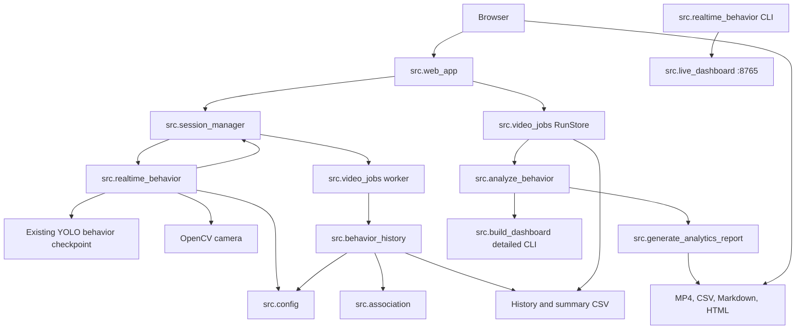

# VisionClass Architecture

This document describes the current source layout. It does not claim that every hardware-dependent path has been verified on every machine.

## Components

| Area | Modules | Responsibility |
|---|---|---|
| Configuration | `src/config.py`, Flask settings in `src/web_app.py` | Project-root defaults, model/dataset/output paths, environment overrides, device selection, web port/upload/run-store settings. |
| Flask application | `src/web_app.py`, `src/templates/`, `src/static/` | Loopback HTTP routes, CSRF/Host/Origin checks, Live, Video Analysis, Analytics pages, stream, artifacts, and downloads. |
| Session ownership | `src/session_manager.py` | Single active background job, state transitions, worker thread, stop request, status snapshots, live history, and cleanup callbacks. |
| Live inference | `src/realtime_behavior.py` | Camera open/read, configured behavior-model loading, per-frame inference/annotation, and status/frame publication to the session manager. |
| Legacy live path | `src/realtime_behavior.py`, `src/live_dashboard.py` | Standalone webcam CLI and standard-library dashboard on port 8765; kept independent of Flask. |
| Video runs | `src/video_jobs.py` | Unique run directories, upload/decoder validation, manifests, video worker creation, analytics/report artifact generation, and safe artifact selection. |
| Video history | `src/behavior_history.py`, `src/association.py` | Frame decoding, person/behavior inference, association, cached history rows, annotated output, history CSV, and per-tracker summary CSV. |
| Analytics and reports | `src/analyze_behavior.py`, `src/generate_analytics_report.py`, `src/build_dashboard.py` | `analyze_behavior.py` owns CSV aggregation; `generate_analytics_report.py` owns run-scoped Markdown and compact HTML reports; `build_dashboard.py` owns the separate detailed interactive dashboard CLI and re-exports the compact generator for CLI compatibility. |
| Optional tracking CLI | `src/classroom_tracking.py` | Standalone person tracking and behavior association workflow. |
| Training/evaluation | `src/train_behavior.py`, `src/evaluate_behavior.py` | Explicit model training and evaluation commands; neither is part of normal app startup. |
| Experimental helpers | `src/features.py`, `feature_extraction.py`, `features_test.py` | `src/features.py` owns reusable MediaPipe feature calculations; `feature_extraction.py` is a standalone webcam demo that consumes them, and neither is wired into YOLO inference. |
| Maintenance tools | `src/analyze_*`, `src/benchmark_*`, `src/diagnose_detections.py`, dataset utilities | Explicitly invoked dataset/model diagnostics and validation. Some create output or perform inference when directly run. |

## Dependency direction

## Principal data flows

### Live webcam

`python -m src.web_app` creates the Flask app and binds to `127.0.0.1` on port 8766 by default. The Live route obtains a CSRF token for the browser session. A valid start request asks `SessionManager` to claim its one active-job slot and start `webcam_session_worker`. The worker resolves settings, loads the configured behavior model, opens the configured camera, and reports status, detections, frame numbers, and annotated JPEGs. Flask exposes the current state and stream to the browser. Stop is cooperative: the worker exits after its current processing iteration and then performs cleanup.

### Video analysis

The upload route asks `RunStore` to create an opaque run ID and isolated directory, stream the validated video payload to a generated filename, and check that OpenCV can decode it. `SessionManager` starts `make_video_worker`; that worker calls the existing `behavior_history.process_video` path and writes run-scoped output. On successful core processing, existing analytics/report functions are invoked where inputs are valid. The manifest advertises only artifacts that exist and completed successfully. Completed runs remain on disk until manually removed outside the app.

### Analytics and report generation

`src/analyze_behavior.py` consumes the existing history and summary CSVs. The Flask result page uses the same functions for run-scoped analytics. Markdown and static HTML reports are generated by the existing report modules; they do not add ground-truth identity. See [How It Works](HOW_IT_WORKS.md) for the record semantics.

## Boundaries

- The Flask app binds only to loopback; it is a local desktop application, not a remote service.
- The legacy standard-library dashboard remains a separate compatibility path on port 8765.
- Model inference and association live outside route functions. Routes own HTTP validation and delegate jobs.
- CSV schemas and aggregation formulas remain in the existing history/analytics modules.
- The run-scoped compact dashboard implementation has one owner in `src.generate_analytics_report`; `src.build_dashboard` retains its CLI-facing `generate_dashboard` alias and separate detailed interactive generator.
- The project currently uses a flat `src` package. Its major runtime responsibilities already have distinct modules; this refactor keeps that simple layout instead of introducing wrapper-only packages.
